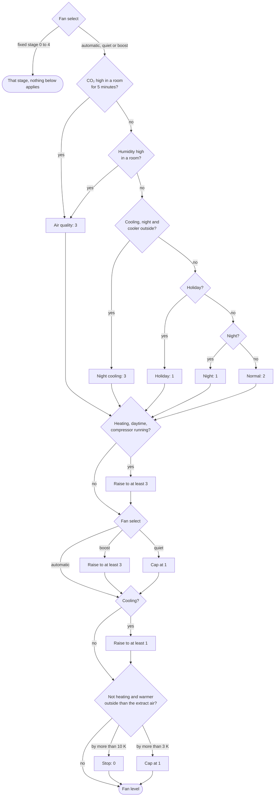
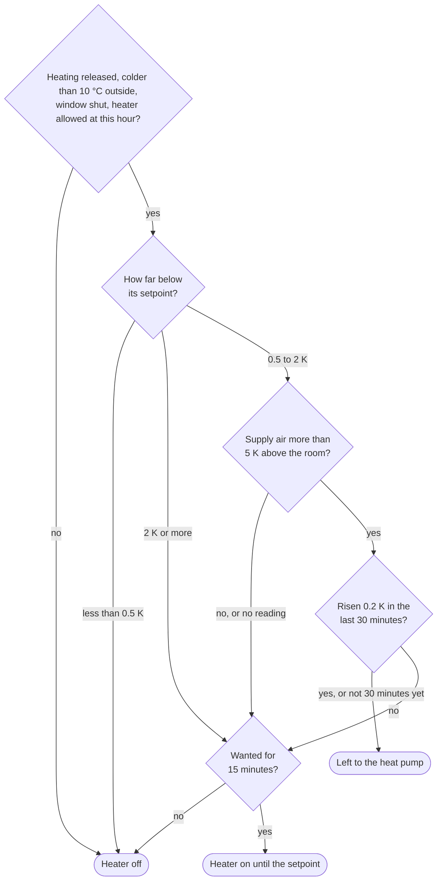

# Schwörer Climate Control

[](LICENSE)
[](https://hacs.xyz/)

A Home Assistant integration that decides what a Schwörer WGT should do, and can
always tell you why it decided that.

It sits on top of the
[schwoerer_lueftung](https://github.com/josa42/homeassistant-schwoerer-lueftung)
integration, which talks Modbus to the device. This one owns the decisions: room
setpoints, when the heat pump is released, which rooms get auxiliary heat, and
what the fan level should be. Rooms the WGT does not heat can join in through any
`climate` entity.

> [!WARNING]
> This is built for one house. The logic, the defaults and the opinions are the
> author's own, and nothing here tries to be a general-purpose climate
> controller. Use it as a starting point, not as a product.

> [!NOTE]
> Nothing is released yet. The decisions it is built from, and the reasoning
> behind them, are written down in [docs/design.md](docs/design.md).

<br><br>

## Installation

### Requirements

- Home Assistant **2026.9.0** or newer
- The [schwoerer_lueftung](https://github.com/josa42/homeassistant-schwoerer-lueftung)
  integration, set up and reporting
- A Schwörer WGT. A WRT has nothing to heat with, so most of this does not apply.

<br><br>

## Configuration

1. Go to **Settings** → **Devices & Services**
2. Click **+ Add Integration** and search for "Schwörer Climate Control"
3. Confirm the unit's entities. They are discovered, so this is normally a matter
   of pressing submit. The form says how many rooms it found on the unit, and
   takes them all on unless you say otherwise. Each room gets its own device.
4. For a room the unit does not heat, choose **Add a room** on the integration
   page. Contacts, humidity and CO₂ sensors belong to other integrations and are
   added per room, through **Change this room**.

Shared settings live on the hub and every room inherits them. Any of them can be
overridden per room, and each decision records both the value it used and which
level it came from.

A room is a name, a thermostat, and whatever measures it. For a room of the unit
the thermostat is its own `climate` entity, whose hvac mode is the auxiliary
heater. For a room the unit does not heat it is any other `climate` entity: a
radiator valve, or a `generic_thermostat` in front of a relay. Hysteresis and
minimum run times belong to that thermostat, which in the case of a
`generic_thermostat` already solves them.

### The unit stays in manual

The controller sets the fan level, both releases and every setpoint itself. The
unit's own seasonal programme would work against that, so the operating mode has
to stay on manual. It is read and never written, and a repair is raised if it
reads anything else.

<br><br>

## How it decides

The mode says which direction of energy is allowed, and it is named after that
rather than after the season:

| Mode | What it allows |
| --- | --- |
| Heating | The heat pump may be released, the auxiliary heaters may run |
| Ventilation | Neither. The base function keeps running |
| Cooling | Cooling may be released, night air may be used |

Holiday is a modifier on top, not a fourth mode, because a holiday in January
still needs frost protection and reduced setpoints while one in July needs
neither.

Below the frost limit, heating happens whatever the mode says. That also holds
when the outdoor reading has gone missing, which is exactly when a freezing house
most needs it.

### The fan level

There is one fan for the whole house, so every room's wish ends up as a single
stage. That stage is built in steps. The first picks a base stage, and each one
after it may raise or cap what the one before it left. The decision sensor names
the step that set the result (`fan_reason`), the room that asked for it
(`fan_requested_by`) and, when a cap lowered it, the stage it came down from
(`fan_capped_from`).



The numbers in the chart are the defaults. Every one of them is a setting on the
hub, under **Configure** → **Temperatures, thresholds and fan levels**.

| Step | What it reads | What it does | Settings |
| --- | --- | --- | --- |
| Fixed stage | The fan select set to 0 to 4 | That stage, whatever anything else says, stage 0 included | |
| CO₂ | Each room's CO₂ sensor | Above 1000 ppm for 5 minutes, the base is 3 | `co2_high` (per room), `fan_air_quality` |
| Humidity | Each room's humidity sensor | Above 70 %, the base is 3, at once | `humidity_high` (per room), `fan_air_quality` |
| Night cooling | Mode, time, outdoor and the warmest room | While cooling at night with it cooler outside, the base is 3 | `fan_night_cooling` |
| Holiday | The holiday switch | The base is 1 | `fan_holiday` |
| Night | The time, 20:00 to 05:00 | The base is 1 | `fan_night`, `night_start`, `night_end` |
| Normal | | The base is 2 | `fan_normal` |
| Heat pump | Mode, time and the heat pump status | While heating by day with the compressor running, at least 3 | `fan_heat_pump` |
| Boost | The fan select | At least 3 | `fan_boost` |
| Quiet | The fan select | At most 1, and the decision records what it capped | `fan_quiet_max` |
| Cooling floor | Mode | While cooling, at least 1, because stage 0 shuts the bypass | |
| Heat protection | Outdoor against extract air | Unless heating: 3 K warmer outside caps at 1, 10 K stops the fan | `heat_cap_above`, `fan_heat_cap`, `fan_off_above` |

A few things follow from the order.

- **Air quality wins over the time of day.** Seventy-eight percent humidity in
  the bathroom raises the fan at night too, because mould costs more than a
  stage of noise. `quiet` is the way to say otherwise. A room with an open window
  asks for nothing, because its sensors are measuring outdoors.
- **The heat pump raises, it never lowers.** The supply air leaves the unit at
  the condenser temperature, around 47 °C on this house against 21 °C in the
  rooms, so moving more air carries more of the compressor's heat into the house.
  A room asking for more than 3 keeps its stage and its name in the decision.
  At night the night stage stays, and a heat pump status that cannot be read does
  not count as running.
- **Heat protection beats air quality.** While it is warmer outside than the air
  leaving the house, ventilating imports heat. Ventilating against indoor
  humidity with 39 °C air makes the humidity worse rather than better, because the
  warmer air carries far more water. It does not apply while heating, where the
  warmth coming in is the point.
- **A fixed stage overrides everything**, heat protection and stage 0 included.

### The auxiliary heaters

A room's auxiliary heater is the expensive second stage, so it is only released
when the heat pump cannot get the room warm on its own. All of this has to hold:

- the mode is heating and the heat pump is released,
- it is colder outside than *auxiliary heat below* (10 °C),
- the window is shut, and it is not night in a room that has the heater off at
  night,
- the room is at least *auxiliary heat from this far below target* (0.5 K) short
  of its setpoint,
- and the heat pump is not getting the room there on its own: either the supply
  air arrives less than *supply air counts as heating* (5 K) above the room, or
  the room has been left to it for 30 minutes and has not risen by 0.2 K.

Warm supply air is a promise rather than a result. On a 4 °C morning the living
room got air 22 K above it for four hours and ended up cooler than it started,
because 40 m³/h at that lift is about 300 W. So a room the supply air would
leave to the heat pump is watched, and each window it rises in starts the next
one from there. A room that stalls keeps that verdict until it reaches its
setpoint, since the heater's own heat makes the room rise and says nothing about
the heat pump. A window opening, the release being withdrawn or a restart of
Home Assistant forgets the progress, and the watch starts over.

From *auxiliary heat regardless* (2 K) short the supply air no longer gets a say.
Without a supply air reading the room decides alone.



A heater is only switched on once it has been wanted for 15 minutes, so a door
left open for a minute or the supply air dipping while the heat pump defrosts
does not start it. The wait starts over after the controller has been switched
off. Once it runs it holds until the room reaches its setpoint or
the supply air clears the margin by a further kelvin.

The house-wide release, register 234, follows the rooms: on while any room may
run its heater, off once none may. It goes on before the rooms are released and
off only after they have been withdrawn. A setup without the entity configured
leaves the register alone. An existing setup finds it suggested under
**Configure** → **Entities**; an entity cleared there stays cleared and is not
suggested again.

The thresholds and the progress window are first estimates, see
[docs/todos/aux-heat-thresholds.md](docs/todos/aux-heat-thresholds.md).

Cooling with the compressor only runs while there is energy to spare. It is the
one expensive thing here, and it waits for a surplus rather than for demand. What
counts as spare is yours to define: give it an on/off entity and it is taken at
its word, or a number read against two thresholds. Production is not surplus, so
in a house with a battery a template sensor of your own is the honest answer.

<br><br>

## Writing as little as possible

Nothing is written unless it differs from what the device reports. In a steady
state that means no Modbus traffic at all, and what is left are real transitions.
A bundle is paced rather than sent at once, and no bundle goes out within a minute
of the last one.

Comparing against the device rather than against a memory of what was sent has two
consequences worth knowing. A write that does not arrive is attempted again on the
next evaluation without anything extra being built. And one that never arrives is
counted, and raises a repair naming the register.

A value the device is not currently reporting is not a difference. After a restart
or a failed poll the current value is unknown, so nothing is written, which is
what stops every register being rewritten whenever Home Assistant starts.

**Dry run** decides and publishes everything and sends nothing. It is on for a
fresh install, so the decisions can be watched for a few days before anything
reaches the unit.

<br><br>

## Entities

| Device | Entities |
| --- | --- |
| Central | Active, holiday and dry run switches, mode and fan selects, decision sensor, inputs-missing indicator, heat recovery sensor |
| Each room | Decision sensor |

**Active** off means no register is written at all. The unit keeps running on its
last values and the decision sensors keep showing what the controller would do,
which makes it the switch to reach for while working out why it did something.

The decision sensor carries the intent as its state, plus the sentence, the inputs
with their age, the conditions with their outcome and every setting with the level
it came from. Those last three are kept out of the recorder, because they change
shape on every evaluation.

<br><br>

## Answering "why was it on at three in the morning"

The sensors answer what is true now. The question is almost always about the past,
so every change also writes a logbook entry carrying the same sentence, per room
and for the unit. A setpoint drifting by a tenth is not a change and does not
appear.

The writes that carry a decision out are sent under the context of its logbook
entry. A changed setpoint or release switch therefore shows the controller, and
its sentence, as what triggered the change, in the logbook and in the entity's
activity.

A decision that has not changed since Home Assistant started has no entry yet.
When the controller writes for it, for example the first write after a restart
or putting back a setpoint someone changed by hand, it first logs the decision
as "Restored: " followed by its sentence, so these writes name the controller
too. A restart that writes nothing logs nothing, and these entries send no
notification.

The **diagnostics** download has the full trace, plus the writes the controller
would send right now and whether each is needed, which is the answer to "it
decided that, so why has nothing happened".

**Inputs missing** turns on as soon as something the controller was told to read
cannot be read, and names it: `wohnzimmer.co2`, `badezimmer.contact[0]`. Each
class of input then falls back to a documented answer rather than disappearing. A
contact that cannot be read counts as open, a missing outdoor reading falls back
to ventilation, and a dead humidity or CO₂ sensor only takes its own rule out.
v1 skipped all of these silently, which is how a flat battery turned into a room
that was heated against an open window.

Four things raise a repair: the unit left manual mode, a configured input has
been unreadable for an hour, a register will not take its value, and the
entities form suggests an entity that was never saved. An input that misses a
single poll is not a repair.

The last one exists because a suggestion looks exactly like a saved value. The
form shows the discovered entity filled in, while the controller works without
it until the form is submitted once. Clearing the field there declines it, and
the repair does not come back for it.

Notifications go to one notify entity, such as your phone from the Companion
app, and gather for five minutes. A legacy notify service like
`notify.mobile_app_phone` still works if it was set up that way. A release
turning over is worth a message, because it is the expensive thing in the house
starting or stopping. A fan level is not.

For debugging, **Notify every change** sends a message for every change of a
system or room decision, the same lines the logbook gets. Room lines start with
the room's name.

<br><br>

## Dashboard

The integration ships a dashboard strategy that builds the whole dashboard from
the entity registry, so a room added later appears on its own.

Create a new dashboard, open its raw configuration editor and put in:

```yaml
strategy:
  type: custom:schwoerer-climate-control
```

You get an overview with the controls and the current decision, and a debug view
laying out the decision behind the unit and behind every room: the sentence, the
conditions with their outcome, the readings with whether they are reporting, and
every setting with the level it came from. To place just one of them inside a
dashboard you already have, use it as a view strategy instead:

```yaml
views:
  - strategy:
      type: custom:schwoerer-climate-control
      view: debug
```

It is built from Home Assistant's own cards, so it installs no custom card and
stays out of the way of
[schwoerer-lueftung-cards](https://github.com/josa42/homeassistant-schwoerer-lueftung-cards).

<br><br>

## The bypass

The bypass damper cannot be commanded. There is no write register for it on any
known firmware, and the unit's own controller drives it. What can be reached are
the conditions it decides from, and two of those the controller writes anyway: the
heating and cooling function has to read cooling for the damper to open at all,
and a room setpoint below the room temperature is the cooling demand it looks for.
Stage 0 shuts it, so cooling never asks for stage 0.

On the unit this was written for, the damper moves and the air does not. Supply air
shows full heat recovery whether the register reports open or closed, which is a
fault in the bypass path rather than in the actuator. Night cooling therefore
cools nothing there until that is found.

That is why the integration publishes the recovery it measures rather than
assuming the lever works. A bypass that starts working shows up at once, and one
that does not cannot be mistaken for a controller that is not trying. The
measurements are in
[docs/research/001-bypass-control.md](https://github.com/josa42/homeassistant-schwoerer-lueftung/blob/main/docs/research/001-bypass-control.md)
in the ventilation repository.

<br><br>

## Development

```bash
make install     # create venv and install test dependencies
make test        # run the test suite
make lint        # run ruff

make dev-up      # start Home Assistant at http://localhost:8123
make dev-restart # restart after code changes
make dev-down    # stop it again
```

`make dev-up` mounts `custom_components/` straight into the container, so the
integration is live in a throwaway Home Assistant without touching your real
instance.

The decision engine and the bypass measurement are pure functions with no Home
Assistant imports, so most of the behaviour is testable directly.

### Releasing

```bash
make release
```

Releases a minor version when a `feat` commit landed since the last release,
otherwise a patch. Pass `VERSION=1.2.3`, `major`, `minor` or `patch` to choose.
Push first: the workflow releases `origin/main`, so `make release` stops on
unpushed or uncommitted changes. The release workflow runs the tests and the
linter first, then bumps the manifest version and `STRATEGY_VERSION`, dates the
changelog, commits, tags, pushes and publishes the release with the zip. A
failure before the push changes nothing.

<br><br>

## License

MIT, see [LICENSE](LICENSE).

<br><br>

## Disclaimer

Unofficial, and not affiliated with or endorsed by Schwörer Haus KG.
